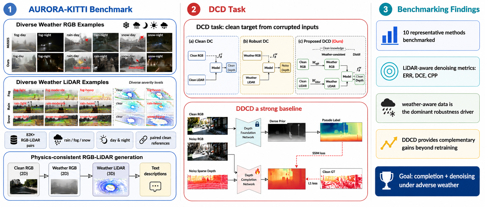

<div align="center">

# AURORA-KITTI: Any-Weather Depth Completion and Denoising

**Information Fusion**, Vol. 139 (2027), 104830

[Yiting Wang](https://warwick-jocelyn.github.io/)<sup>1,3,4</sup> · Tim Brödermann<sup>2</sup> · Hamed Haghighi<sup>1</sup> · Haonan Zhao<sup>1</sup> · Christos Sakaridis<sup>3</sup> · Kurt Debattista<sup>1</sup> · Valentina Donzella<sup>4</sup>

<sup>1</sup>WMG, University of Warwick · <sup>2</sup>CVL, ETH Zürich · <sup>3</sup>PRS, ETH Zürich · <sup>4</sup>SEMS, Queen Mary University of London

[](https://doi.org/10.1016/j.inffus.2026.104830)
[](https://doi.org/10.1016/j.inffus.2026.104830)
[](LICENSE)

</div>



---

## Overview

Depth completion breaks down in rain, fog and snow, where **both** the camera image and the LiDAR return are corrupted. We address this with:

- **DCD** — *Depth Completion and Denoising*: recover clean, dense, metric depth from weather-corrupted RGB **and** weather-corrupted sparse LiDAR, in one task.
- **AURORA-KITTI** — the first large-scale, physics-consistent synthetic RGB–LiDAR benchmark for DCD. **82,177** pairs, cross-modally matched degradation, paired clean references, dense metric GT.
- **DDCD** — a distillation baseline that transfers a clean-image foundation prior to the completion network. Teacher sees the clean image *at training time only*; at inference the model sees only degraded RGB + sparse LiDAR.

## Dataset at a glance

| | |
|---|---|
| Pairs | 82,177 (46,968 weather frames + matched clean references) |
| Weather | clear · fog · rain · snow, 3 severity levels |
| Illumination | day / night (8 compound conditions) |
| Scenarios | city · residential · road |
| Lens conditions | clean · adherent raindrops · adherent snowflakes |
| Modalities | weather RGB, weather sparse depth, LiDAR height & intensity, dense metric GT, calibration |
| Per-frame labels | weather, severity, time of day, ground/sky/lens condition, scenario |
| Resolution | 1242×375 (train) · 1216×352 (test) |
| Splits | 40,303 train · 3,309 val · 3,356 test |

Built on [KITTI-DC](https://www.cvlibs.net/datasets/kitti/eval_depth.php?benchmark=depth_completion); clean reference frames come from KITTI raw.

## Results (RMSE, mm)

| Method | Input | AURORA-KITTI test | DENSE (real) |
|---|---|---:|---:|
| IP-Basic (multi) | LiDAR | 6916.28 | 7346.78 |
| BP-Net | RGB+L | 4945.43 | 4946.62 |
| CompletionFormer | RGB+L | 3961.99 | 4754.04 |
| UniK3D | RGB | 3716.06 | 3509.04 |
| **DDCD (ours)** | RGB+L | **1801.93** | **2761.97** |

All rows except DDCD are zero-shot off-the-shelf checkpoints; DDCD is trained in-domain. Full 13-method tables, LiDAR-aware denoising metrics (ERR / DCE / CPP) and ablations are in the paper.

## Downloads

| | Link |
|---|---|
| **Dataset** (36.7 GB) | [🤗 JocelynW/AURORA-KITTI](https://huggingface.co/datasets/JocelynW/AURORA-KITTI) |
| **Checkpoints** (1.7 GB) | [🤗 JocelynW/AURORA-KITTI-models](https://huggingface.co/JocelynW/AURORA-KITTI-models) |

```bash
# dataset — start with the test split (2.6 GB) to reproduce the benchmark
hf download JocelynW/AURORA-KITTI --repo-type dataset \
    --include "data/*_test.tar" "annotations/*" --local-dir aurora-kitti

# checkpoints
hf download JocelynW/AURORA-KITTI-models --local-dir checkpoints
```

## Model zoo

| Checkpoint | Model |
|---|---|
| `ddcd_aurora.pth` | **DDCD** — the proposed baseline |
| `ddcd_noisy_prior.pth` | DDCD, distilled from a noisy-RGB teacher (ablation) |
| `ddcd_no_teacher_norm.pth` | DDCD, teacher normalisation disabled (ablation) |
| `bpnet_aurora.pth` | BP-Net retrained on AURORA-KITTI |
| `completionformer_aurora.pth` | CompletionFormer retrained on AURORA-KITTI |

`ddcd_aurora.pth` reproduces the published results exactly — AURORA-KITTI test RMSE **1801.93 mm**,
DENSE RMSE **2761.97 mm** — verified with
[`validate_against_paper.py`](Depth_Models/benchmark/validate_against_paper.py).

## Code

| Folder | Contents |
|---|---|
| [`Depth_Models/`](Depth_Models) | DDCD, benchmark harness, dataset tooling, and our adaptations of 11 baselines |
| [`Simulation/`](Simulation) | RGB weather rendering (fog, rain, snow), LiDAR corruption, projection, realism validation |

Baselines are not vendored — [`Depth_Models/UPSTREAM.md`](Depth_Models/UPSTREAM.md) pins the exact
upstream commit of each repository.

## Citation

```bibtex
@article{wang2027aurorakitti,
  title   = {AURORA-KITTI: Any-weather depth completion and denoising},
  author  = {Wang, Yiting and Br{\"o}dermann, Tim and Haghighi, Hamed and
             Zhao, Haonan and Sakaridis, Christos and Debattista, Kurt and
             Donzella, Valentina},
  journal = {Information Fusion},
  volume  = {139},
  pages   = {104830},
  year    = {2027},
  doi     = {10.1016/j.inffus.2026.104830}
}
```

## Contact

Yiting Wang — <Yiting.Wang.1@warwick.ac.uk>

Partially funded by the CDT to Advance the Deployment of Future Mobility Technologies and the EU Horizon ROADVIEW project. Part of this work was carried out at PRS, ETH Zürich.
